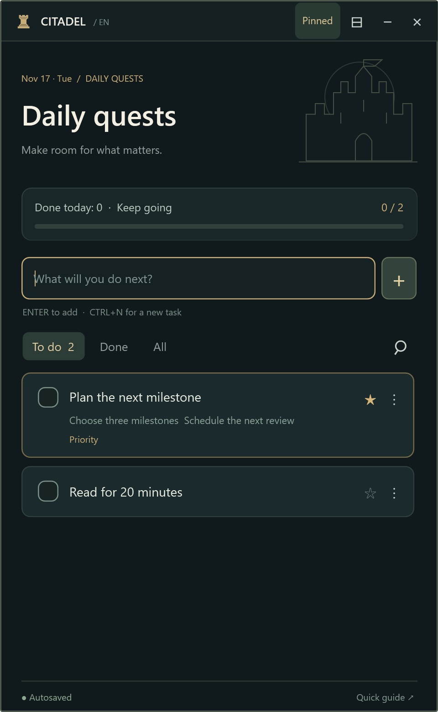

# Citadel / 暮堡

> Scroll down for Chinese version

# English

A Windows desktop task list with an English interface, a dark castle theme, and four window sizes. Keep your next steps visible above other apps, mark priorities, and celebrate completed tasks with a short animation.

### Run

1. Extract the complete archive.
2. Open `release/citadel English Version.exe`.
3. Keep `citadel English Version.exe.config` beside the executable.

The application runs on Windows 10 or Windows 11 with .NET Framework 4.7.2 or later. You can copy the whole `release` folder to another location.

### Features

- Add a task by typing a title and pressing Enter or clicking `+`.
- Click a task title to edit its title and notes. Mark important tasks with the star; they appear first.
- Click the checkbox to complete a task. A short glow and particle animation confirms completion. Completed tasks can be restored to the active list.
- Open the `⋮` menu for editing or deletion, with pencil and trash icons. Undo the most recent completion or deletion within seven seconds.
- Filter active, completed, or all tasks, and search titles and notes.
- Keep the window above ordinary desktop windows using the pin button. Pinning is on by default and does not repeatedly take keyboard focus.
- Move the window by dragging the top bar, or resize it by dragging an edge.
- Changes, window position, pin state, and window sizes are saved automatically.

Pinning does not guarantee visibility above Windows security screens, exclusive full-screen applications, or other windows that are also pinned.

### Four window sizes

Click the window-size button in the upper-right corner, or press **Ctrl+M**, to cycle through these modes and return to Full panel:

| Mode | Default size | Task presentation |
| --- | --- | --- |
| Full panel | 480 × 780 | Large heading, progress, notes, and task details |
| Classic | 380 × 520 | The original small window, with notes and task details |
| Mini | 300 × 340 | Compact rows with one-line task titles |
| Tiny | 260 × 220 | The smallest preset, with a scrollable task list |

Sizes are Windows logical pixels and follow your display scaling. Each mode remembers its own resized dimensions, and the application restores the last selected mode when reopened. Hover over the size button to see the current and next modes.

In Mini and Tiny, hover over a task title to read the full title and notes. Editing temporarily expands a small window; closing the editor restores its previous size and position.

### Keyboard shortcuts

| Shortcut | Action |
| --- | --- |
| Enter | Add the task in the new-task input |
| Ctrl+N | Focus the new-task input |
| Ctrl+F | Search tasks |
| Ctrl+T | Toggle pinning |
| Ctrl+M | Cycle through the four window sizes |
| Ctrl+Enter | Save changes in the editor |
| Esc | Close the editor or collapse search |

### Dates and completion counts

Task timestamps come from your computer's Windows system clock. The application stores them in UTC and displays them in your local time zone. It does not obtain the time from an online service.

The daily completion count includes tasks that are currently completed and whose completion timestamp falls on today's local date. The progress bar shows the completed share of all tasks. About every 30 seconds, the application checks for a date or time-zone-offset change and refreshes the display. A new day does not clear your tasks.

Restoring a completed task clears its completion timestamp. Completing it again records a new timestamp; Undo restores the previous state and timestamp. An incorrect computer clock can affect recorded times and daily counts.

---

# 中文

一款采用深色城堡风格的桌面待办软件。将接下来要做的事放在其他窗口上方，标记重点，并通过简短动画反馈任务完成。支持四档窗口大小，让待办清单适应不同的桌面空间。

### 运行

1. 完整解压压缩包；如果旧版正在运行，请先关闭。
2. 打开 `release-v3/Citadel.exe`。
3. 将 `Citadel.exe.config` 保持在程序旁边。

支持 `Windows 10 / 11`，需要安装微软桌面运行环境（`.NET Framework 4.7.2` 或更高版本）。可以把整个 `release-v3` 文件夹复制到其他位置使用，无需另行安装开发工具。

### 功能

- 输入任务标题，按回车键或点击加号添加。
- 点击任务文字编辑标题和备注。点击星号标记重点，重点任务优先显示。
- 点击复选框完成任务，播放短暂的亮起和碎光动画。已完成任务可以恢复为待办。
- 点击 `⋮` 打开菜单，铅笔图标用于编辑，垃圾桶图标用于删除。最近一次完成或删除操作可在七秒内撤销。
- 筛选待办、已完成或全部任务，并搜索标题和备注。
- 通过置顶按钮保持在普通桌面窗口上方。默认开启置顶，不会反复抢走键盘焦点。
- 拖动顶部移动窗口，拖动边缘调整大小。
- 自动保存任务修改、窗口位置、置顶状态和各档窗口尺寸。

置顶不保证覆盖系统安全界面、独占全屏程序或其他置顶窗口。

### 四档窗口大小

点击右上角的窗口大小按钮，或按快捷键 `Ctrl+M`，按下列顺序循环切换，最后回到完整面板：

| 档位 | 默认尺寸 | 任务展示 |
| --- | --- | --- |
| 完整面板 | 480 × 780 | 大标题、进度、备注和任务详情 |
| 经典小窗 | 380 × 520 | 保留最初小窗大小，显示备注和任务详情 |
| 迷你小窗 | 300 × 340 | 紧凑列表，任务标题显示为一行 |
| 极简小窗 | 260 × 220 | 最小预设，任务列表可以滚动 |

尺寸单位为系统逻辑像素，会跟随显示缩放。四档分别记住调整后的大小，重新打开时恢复上次使用的档位。悬停在窗口大小按钮上，可以查看当前档位和下一档。

在迷你小窗和极简小窗中，悬停在任务文字上可查看完整标题和备注。编辑时小窗会临时展开，关闭编辑后恢复原来的大小和位置。

### 快捷键

| 快捷键 | 功能 |
| --- | --- |
| 回车键 | 添加新任务输入框中的任务 |
| `Ctrl+N` | 聚焦新任务输入框 |
| `Ctrl+F` | 搜索任务 |
| `Ctrl+T` | 切换置顶 |
| `Ctrl+M` | 循环切换四档窗口大小 |
| `Ctrl+Enter` | 保存编辑 |
| 退出键（`Esc`） | 关闭编辑或收起搜索 |

### 时间与完成统计

任务时间来自电脑的系统时钟，内部使用协调世界时保存，显示时换算成电脑本地时区。程序不会通过网络获取时间。

当天完成数只统计目前仍处于已完成状态、且完成时间属于电脑本地当天日期的任务。进度条表示全部任务中的完成比例。程序约每三十秒检查日期或时区偏移是否变化，并刷新显示；跨日不会清空任务。

将任务恢复为待办时，会清除其完成时间；再次完成时记录新的时间。撤销操作会恢复原状态和原时间。电脑时间不准确时，任务时间和当天统计也可能受到影响。
